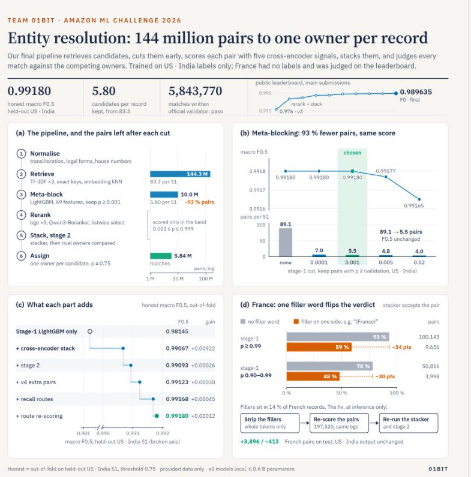
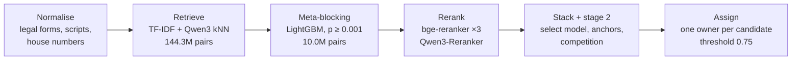

<div align="center">

# Entity Resolution at Scale
### Amazon ML Challenge 2026 · Team 01BIT

**144 million candidate pairs → one owner per record, at 0.9896 macro F0.5**


</div>



## The task

Three business-record tables (S1, S2, S3) describe the same real-world companies with noisy names and addresses: legal-form drift, abbreviations, typos, native-script transliteration, and house numbers that differ by one digit. For every S1 record, find all its matching S2/S3 records, never matching across countries.

The metric is **macro F0.5**, which weights precision over recall. A single wrong merge on a singleton S1 costs a full point for that S1, so the whole design is tuned for precision first.

France has **no training labels**. It is handled with language-aware normalisation built only from the test inputs and a rule against sibling-business confusions.

## Results

| | Score |
|---|---:|
| Public leaderboard (final, F0) | **0.989635** |
| Honest held-out macro F0.5, US + India | **0.99180** (India 0.99227, US 0.99149) |
| Candidates per S1 after meta-blocking | **5.80** (from 83.3) |
| Matches in the final submission | 5,843,770 |

### What each stage adds (honest held-out, US/India)

| Stage | F0.5 | Gain |
|---|---:|---:|
| Stage-1 LightGBM only | 0.98145 | |
| + cross-encoder stack | 0.99067 | +0.00922 |
| + stage-2 re-scorer | 0.99093 | +0.00026 |
| + v4 extra pairs | 0.99123 | +0.00030 |
| + recall routes | 0.99168 | +0.00045 |
| + route re-scoring | **0.99180** | +0.00012 |

## How it works



1. **Normalise:** legal forms, abbreviations, house numbers, native script to Latin. France gets its own filler-word and run-together-domain handling.
2. **Retrieve:** TF-IDF on name, address and mixed text, exact keys, and Qwen3-Embedding-0.6B nearest neighbours, always within one country. Union recall on the held-out fold is 98.8%.
3. **Meta-blocking:** a lightweight LightGBM prunes 144.3M pairs to 10.0M, and the final test output is byte-identical to the uncut run. Heavy models only run on what survives.
4. **Rerank:** four fine-tuned cross-encoders (bge-reranker-v2-m3 ×3, Qwen3-Reranker-0.6B) plus a listwise "select" model that reads a candidate together with all S1s competing for it.
5. **Stack and re-score:** a cross-fitted LightGBM stacker, then a stage-2 model that uses each S1's other confident matches and competition between S1s.
6. **Assign:** one owner per candidate at the F0.5-optimal threshold of 0.75.

### Key ideas

- **Meta-blocking costs no accuracy.** Cutting from 89 to 5.5 pairs per S1 leaves honest F0.5 unchanged (0.99180) while the heavy models see far fewer pairs.
- **Honest cross-fitting everywhere.** Every reranker score comes from a model that never saw that S1's labels, so the stacker trains on test-like scores and validation gains transferred to the leaderboard.
- **Listwise selection.** Pairwise models score each (S1, candidate) independently. The select model sees the whole contest and resolves sibling-S1 conflicts, about 10% of the residual loss.
- **One filler word flips the verdict in France.** 14% of French records carry generator-injected filler words that the rerankers read as a different business. Stripping them at inference time added 3,896 pairs and removed 413, with no retraining.

See [docs/METHODOLOGY.md](docs/METHODOLOGY.md) for the full write-up: problem analysis, blocking trade-offs, features, models, licences, error analysis, and everything tried and not adopted.

## Repository layout

```
.
├── README.md
├── run_pipeline.sh            # single entry point, regenerates both output files
├── requirements.txt           # pinned dependencies
├── src/
│   ├── normalize.py, translit.py, fr_renorm.py        # normalisation
│   ├── block.py, embed_*.py, text_tables.py           # candidate generation
│   ├── features.py, train.py, score_test.py           # 69 features + stage-1 LightGBM
│   ├── stage2.py, decide.py, fr_*.py, splice_country.py
│   ├── reranker/              # cross-encoders, select model, stacker
│   └── routes/                # second-pass shortlist routes
├── docs/
│   ├── METHODOLOGY.md         # full solution write-up
│   ├── REPRODUCTION.md        # environment, run time, code map
│   └── assets/overview.png
├── data/                      # put the challenge data here (git-ignored)
└── output/                    # result files (git-ignored, see output/README.md)
```

## Quick start

```bash
git clone https://github.com/AdityaOnam/Amazon-ML-Challenge.git
cd Amazon-ML-Challenge

python -m venv .venv && source .venv/bin/activate
pip install torch==2.11.0 --index-url https://download.pytorch.org/whl/cu128   # match your CUDA driver
pip install -r requirements.txt

# place the challenge data under data/dataset/{train,test}/ (layout in docs/REPRODUCTION.md)
bash run_pipeline.sh
```

**Requirements:** Python 3.12, Linux, one CUDA GPU with 24 GB (20 GB works with smaller batches), up to 64 CPU threads and about 200 GB RAM at peak. A full run takes roughly 20–30 h on an A100/L40S-class GPU. The only network access is downloading pretrained weights from Hugging Face.

Full details, including the per-step code map, are in [docs/REPRODUCTION.md](docs/REPRODUCTION.md).

## Output

| File | Content |
|---|---|
| `output/matching_results.tsv` | `source1_entity_id` → comma-separated matched S2/S3 ids (final submission) |
| `output/candidate_pairs.tsv` | the 10.0M pairs that survived meta-blocking |

Both files are too large for a normal git push (up to 152 MB), so they are git-ignored. Download them from the Releases page or regenerate them.

## Models

| Model | Use | Licence |
|---|---|---|
| Qwen/Qwen3-Embedding-0.6B | blocking embeddings | Apache-2.0 |
| BAAI/bge-reranker-v2-m3 | 3 cross-encoders + 4 listwise select models | Apache-2.0 |
| Qwen/Qwen3-Reranker-0.6B | 1 cross-encoder | Apache-2.0 |
| LightGBM | stage 1, stacker, stage 2, route models | MIT |

All models are under 8B parameters. No API models, no external data, no LLM-generated data.

## Team

**01BIT** · Amazon ML Challenge 2026 · [github.com/AdityaOnam/Amazon-ML-Challenge](https://github.com/AdityaOnam/Amazon-ML-Challenge)
