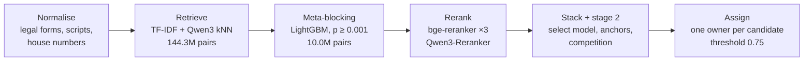

<div align="center">

# Entity Resolution at Scale
### Amazon ML Challenge 2026 · Team 01BIT

**Turning 144 million candidate pairs into one owner per record at 0.9896 macro F0.5**


</div>

---

## At a glance

| Public leaderboard | Held-out macro F0.5 | Blocking recall | Pair reduction |
|:---:|:---:|:---:|:---:|
| **0.989635** | **0.99180** | **98.8%** | **144.3M → 10.0M** |
| final submission (F0) | US + India, honest cross-fit | union of all retrieval routes | **14.4×** fewer pairs, **0** F0.5 lost |

| Candidates per S1 | S1 records resolved | Matches submitted | Model size |
|:---:|:---:|:---:|:---:|
| **83.3 → 5.80** | **1,732,544** | **5,843,770** | **≤ 0.6B** params each |
| after meta-blocking | test set, 3 countries | S1 → S2/S3 links | no API models, no external data |

---

## Objectives

| # | Objective | Why it matters | Outcome |
|:-:|---|---|---|
| 1 | **Maximise macro F0.5** | The metric weights precision over recall. One wrong merge on a singleton S1 costs that S1 a full point. | **0.99180** held-out, **0.989635** public LB |
| 2 | **Keep recall high at the blocking stage** | A true match that is never retrieved can never be predicted. | **98.8%** union recall on the held-out fold |
| 3 | **Make heavy models affordable** | Running cross-encoders on 144M pairs is not feasible. | Meta-blocking cuts to **10.0M** pairs with a **byte-identical** final output |
| 4 | **Prevent validation leakage** | Stacked models trained on in-sample scores overfit and do not transfer. | Every score is **cross-fitted**, and held-out gains carried over to the leaderboard |
| 5 | **Generalise to an unseen country** | France has **no training labels** at all. | Language-aware normalisation from test inputs only: **+3,896 / −413** pairs from filler cleaning |
| 6 | **Stay within competition rules** | Models must be open, under 8B parameters, with no external or LLM-generated data. | All models Apache-2.0 / MIT, the largest at **596M** parameters |

---

## The problem

Three business-record tables (**S1**, **S2**, **S3**) describe the same real-world companies, but with noisy names and addresses. For every S1 record, the task is to find all matching S2/S3 records, never matching across countries.

| Noise source | Example |
|---|---|
| Legal-form drift | `Pvt Ltd` ↔ `Private Limited` ↔ `Corp` |
| Abbreviations and reordering | `Rd` ↔ `Road`, landmarks such as `Near SBI ATM` |
| Transliteration | Devanagari and other native scripts ↔ Latin |
| Domain-style names | `abcmotors.com` |
| House-number edits | a one-digit difference is often a **different** business |
| Missing addresses | many candidates have an empty address field |

**Where the residual loss sits:** about **63%** of the remaining validation loss comes from candidates with no address whose name is shared by several S1s. Nothing in the records says which S1 owns them, so these are close to the irreducible floor.

---

## Results

### Headline scores

| Metric | Score |
|---|---:|
| Public leaderboard, final submission (F0) | **0.989635** |
| Honest held-out macro F0.5, US + India | **0.99180** |
| ↳ India | 0.99227 |
| ↳ United States | 0.99149 |

### Contribution of each stage (honest held-out, US + India)

| Stage | F0.5 | Gain |
|---|---:|---:|
| Stage-1 LightGBM (69 features) | 0.98145 | baseline |
| + cross-encoder stack | 0.99067 | **+0.00922** |
| + stage-2 re-scorer | 0.99093 | +0.00026 |
| + v4 extra pairs | 0.99123 | +0.00030 |
| + recall routes | 0.99168 | +0.00045 |
| + route re-scoring | **0.99180** | +0.00012 |
| **Total gain over stage 1** | | **+0.01035** |

### Meta-blocking: fewer pairs, same accuracy

| First-stage cut | Pairs per S1 | F0.5 |
|---|---:|---:|
| none | 89.1 | 0.99180 |
| p ≥ 0.0001 | 7.0 | 0.99180 |
| **p ≥ 0.001 (used)** | **5.5** | **0.99180** |
| p ≥ 0.005 | 4.8 | 0.99177 |
| p ≥ 0.02 | 4.0 | 0.99165 |

---

## Pipeline



| Step | What it does | Key number |
|:-:|---|---|
| **1. Normalise** | Legal forms, abbreviations, house numbers, native script to Latin. France gets its own filler-word and run-together-domain handling. | US, India, France |
| **2. Retrieve** | TF-IDF on name, address and mixed text, exact keys, and Qwen3-Embedding-0.6B nearest neighbours, always within one country. | **144.3M** pairs, **98.8%** recall |
| **3. Meta-block** | A lightweight LightGBM keeps only pairs with p ≥ 0.001, so heavy models see a fraction of the data. | **10.0M** pairs, **5.80** per S1 |
| **4. Rerank** | Four fine-tuned cross-encoders, plus a listwise *select* model that reads one candidate with all competing S1s. | **4** cross-encoders + **1** select model |
| **5. Stack and re-score** | A 5-fold cross-fitted LightGBM stacker, then a stage-2 model using each S1's confident matches and S1-vs-S1 competition. | **+0.00026** from stage 2 |
| **6. Assign** | One owner per candidate at the F0.5-optimal threshold. | threshold **0.75** |

---

## Key technical contributions

> **1. Meta-blocking at zero accuracy cost**
> Cutting from **89.1 to 5.5** pairs per S1 leaves honest F0.5 unchanged at **0.99180**, and the final test output is byte-identical to the uncut run.

> **2. Honest cross-fitting everywhere**
> Train S1s are split into two halves. Each reranker is fine-tuned on one half and scores the other, so every score comes from a model that never saw that S1's labels. The stacker trains on test-like scores and validation gains transfer to the leaderboard.

> **3. Listwise candidate selection**
> Pairwise models score each (S1, candidate) independently. The select model sees the whole contest (one candidate, up to **6** competing S1s) and resolves sibling-S1 conflicts, which account for about **10%** of the residual loss.

> **4. Second-pass recall routes**
> Confident first-pass matches act as anchors to search for an S1's remaining matches, recovering blocking misses in crowded-name groups at **96%** precision.

> **5. Unseen-country adaptation without labels**
> **14%** of French records carry generator-injected filler words that the rerankers read as a different business. Stripping them at inference time re-scored **197,520** pairs, adding **3,896** and removing **413**, with no retraining.

The full write-up (problem analysis, blocking trade-offs, features, models, licences, error analysis and everything tried and not adopted) is in [docs/METHODOLOGY.md](docs/METHODOLOGY.md).

---

## Quick start

```bash
git clone https://github.com/AdityaOnam/Amazon-ML-Challenge.git
cd Amazon-ML-Challenge

python -m venv .venv && source .venv/bin/activate
pip install torch==2.11.0 --index-url https://download.pytorch.org/whl/cu128   # match your CUDA driver
pip install -r requirements.txt

# place the challenge data under data/dataset/{train,test}/ (layout in docs/REPRODUCTION.md)
bash run_pipeline.sh
```

### System requirements

| Resource | Requirement |
|---|---|
| Python | 3.12 on Linux |
| GPU | 1 × CUDA GPU, **24 GB** (20 GB works with smaller batches) |
| CPU | up to **64** threads |
| RAM | about **200 GB** at peak |
| Run time | roughly **20–30 h** on an A100 / L40S-class GPU |
| Network | only to download pretrained weights from Hugging Face |

The per-step code map and environment details are in [docs/REPRODUCTION.md](docs/REPRODUCTION.md).

---

## Output

| File | Content | Size |
|---|---|---|
| `output/matching_results.tsv` | `source1_entity_id` → comma-separated matched S2/S3 ids (final submission) | 5,843,770 matches |
| `output/candidate_pairs.tsv` | pairs that survived meta-blocking | 10,049,484 pairs |

Both files are too large for a normal git push (up to 152 MB), so they are git-ignored. Download them from the Releases page or regenerate them with `run_pipeline.sh`.

---

## Models

| Model | Role | Parameters | Licence |
|---|---|---:|---|
| Qwen/Qwen3-Embedding-0.6B | blocking embeddings | 0.6B | Apache-2.0 |
| BAAI/bge-reranker-v2-m3 | 3 cross-encoders + 4 listwise select models | 568M | Apache-2.0 |
| Qwen/Qwen3-Reranker-0.6B | 1 cross-encoder | 596M | Apache-2.0 |
| LightGBM | stage 1, stacker, stage 2, route models | – | MIT |

All models are under 8B parameters. No API models, no external data and no LLM-generated data were used.

---

## Repository layout

```
.
├── README.md
├── run_pipeline.sh            # single entry point, regenerates both output files
├── requirements.txt           # pinned dependencies
├── src/
│   ├── normalize.py, translit.py, fr_renorm.py        # normalisation
│   ├── block.py, embed_*.py, text_tables.py           # candidate generation
│   ├── features.py, train.py, score_test.py           # 69 features + stage-1 LightGBM
│   ├── stage2.py, decide.py, fr_*.py, splice_country.py
│   ├── reranker/              # cross-encoders, select model, stacker
│   └── routes/                # second-pass shortlist routes
├── docs/
│   ├── METHODOLOGY.md         # full solution write-up
│   └── REPRODUCTION.md        # environment, run time, code map
├── data/                      # challenge data goes here (git-ignored)
└── output/                    # result files (git-ignored, see output/README.md)
```

---

<div align="center">

**Team 01BIT** · Amazon ML Challenge 2026 · [github.com/AdityaOnam/Amazon-ML-Challenge](https://github.com/AdityaOnam/Amazon-ML-Challenge)

</div>
